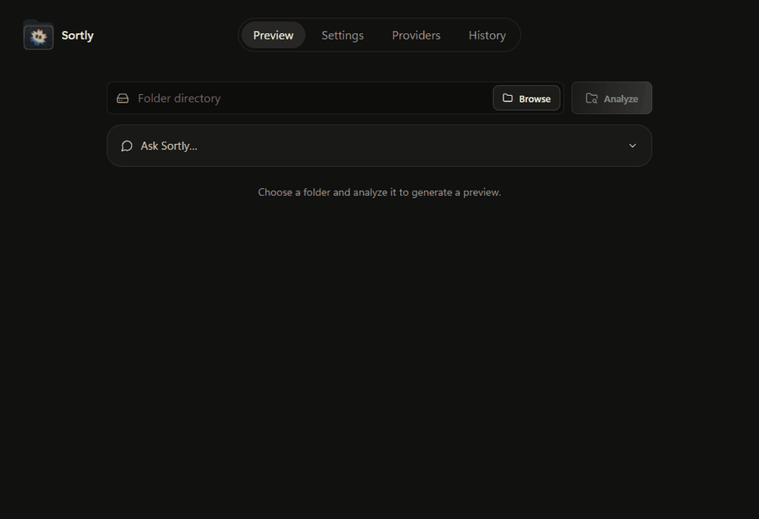

# Sortly

**Organize files by their contents. Review every change before it happens.**

Sortly is a desktop file organizer for Windows, Linux, and macOS with optional LLM instructions, editable rename suggestions, and undo. Folder names come from your files and instructions rather than a fixed category list.

Optional local semantic candidates and versioned chat naming
rules are documented in [Hybrid file intelligence](docs/hybrid-file-intelligence.md).
Its [evaluation guide](docs/hybrid-evaluation.md) separates fixture checks from real-model accuracy and speed measurements.

[Download Sortly 2.0.1](https://github.com/Advay-01/Sortly/releases/tag/v2.0.1) · [What's new](CHANGELOG.md) · [Report an issue](https://github.com/Advay-01/Sortly/issues)

| Your system | Download |
| --- | --- |
| Windows x64 | [`Sortly_2.0.1_windows-x64.zip`](https://github.com/Advay-01/Sortly/releases/download/v2.0.1/Sortly_2.0.1_windows-x64.zip) — extract, then run `Sortly_2.0.1_x64-setup.exe` |
| Linux x64 | `.deb` for Debian/Ubuntu, or `.AppImage` |
| macOS Apple Silicon | `_aarch64.dmg` |

Installers include the local service: Python and Node.js are not required. The Windows ZIP contains the installer, rather than a portable standalone app. `SHA256SUMS` files are optional integrity checks, not the application download. Windows builds are unsigned; macOS builds use ad-hoc signing and are **not Apple notarized**, so macOS may require approval in Privacy & Security. The macOS build targets version 13 or newer. Linux packages are built on Ubuntu 22.04; compatibility with every distribution is not guaranteed.

## Fixed in 2.0.1

HTML pages whose local resources are already missing now show a preview warning. They remain excluded by default for review, but explicitly including them no longer blocks Apply solely because those resources were already absent. Working links stay protected, and assets added after analysis are checked again before Apply.

## New in 2.0

- Optional local embeddings use **MiniLM** by default; **Qwen 0.6B** is an alternative download. Settings expose model availability, download progress and CPU/GPU preferences. Ollama and model weights are installed separately, keeping them out of the app download.
- Local extraction, file relationships and embeddings help the LLM plan dynamic folders and grounded names. Larger uncached datasets share a dataset-derived folder plan across bounded concurrent requests. Small folders can skip embeddings; the default automatic gate is 75 eligible files and can be configured.
- Chat can group code by verified language, change naming preferences, merge proposed folders and refine the preview. Original date and version tokens are preserved during renaming. Folder switches include every member when explicitly enabled.
- History shows a folder tree, collapsed by default. Expand folders to inspect their files; Undo remains available, including partial-recovery retries.
- Privacy checks cover labelled passport/Aadhaar records and payment-card details. Redaction removes complete private-key blocks. Strong local format detection improves misleading extensions without weakening Apply's identity, SHA-256 or path checks.

## See it work



The animation records the running app using a real configured LLM and sample files. Waiting time is shortened for readability; the responses and file operations are real. Your own results depend on the files and selected model.

## Organize a folder

1. Open **Providers**, choose a provider and model, and test the configuration.
2. In **Preview**, browse to a folder. Enable **Include subfolders** in Settings if you want to include nested files.
3. Optionally use **Ask Sortly**: “Put DSA notes and LeetCode solutions together” or “Leave Projects alone.” You can give instructions before or after analysis.
4. Choose **Analyze**. Review the compact file rows, destination groups, proposed names, extension changes, and warnings. Open **Details** to edit a suggestion or inspect its evidence.
5. Choose **Review & organize**, then **Confirm moves**. Files move only after this confirmation. The resulting folder tree appears after the operation.

Use **History** to expand previous operations' folder trees and access per-run Undo. The trees show recorded destinations rather than a live filesystem scan. The completed operation also offers Undo and Open folder.

## What you can do

| Feature | Behavior |
| --- | --- |
| Content-based organization | Extracts bounded text and metadata, then proposes a dynamic category and subcategory. Existing folders are reused when they fit the subject. |
| Ask Sortly | Answer questions about a preview, group files by topic or verified code language, match extensions or relative paths, exclude files, and set naming preferences. Newer instructions override conflicting earlier ones. |
| Rename suggestions | Proposes descriptive names grounded in extracted evidence. Names over 80 characters also get a shorter suggestion when **Suggest cleaner file names** is enabled. |
| Clear review | An unchanged file uses one row; extra information appears for renames, extension changes, warnings, and edited destinations. Full details stay expandable. |
| Safe reruns | A file already at its intended location keeps its name, including an existing collision suffix, and is counted as already organized. |
| Undo | Records completed moves and restores original paths and names when those paths are available. Conflicts are reported. |
| Provider choice | Supports OpenAI, Anthropic, Google Gemini, DeepSeek, Groq, OpenRouter, Hugging Face, and local Ollama, with optional ordered fallbacks. |

### Ask Sortly examples

- “Why is this presentation in that folder?”
- “Put all PDFs in Documents/PDFs.”
- “Group recipes and the grocery list under Personal/Food.”
- “Leave everything inside Projects alone.”
- “Group code by language and put notes, invoices and recipes under Documents.”
- “Keep original names” or “Shorten generic names while preserving dates.”

Chat rules only refine a plan. Naming rules change preview suggestions; Apply still requires confirmation. Chat cannot delete files, execute file contents, or move detected sensitive files. Targets are limited to one or two relative folder levels. Topic matching uses the model when local evidence cannot resolve it completely; extension, path, proposed-folder and verified-language grouping run locally after the instruction has been translated into rules.

Chat stays available when switching tabs and reanalyzing the same folder. Selecting a **different folder** clears its conversation, draft, and instructions. Cancelling Browse or selecting the same folder keeps them. Instructions entered before selecting the first folder are retained for that first analysis.

### Settings

| Setting | Default | Effect |
| --- | --- | --- |
| Include subfolders | Off | Scans nested folders as well as the selected folder. |
| Suggest cleaner file names | On | Enables evidence-based names and automatic shortening of very long names. |
| Reorganize already sorted files | Off | Requests fresh classification instead of reusing cached analysis. |
| Allow redacted cloud analysis for sensitive files | Off | Allows an explicitly enabled redacted request; sensitive files remain unselected by default. |
| Local embeddings | Off | Optional semantic candidates; automatic mode skips folders below the configurable 75-file gate. Forced mode is available for evaluation. |
| Embedding model | MiniLM | Choose local MiniLM or Qwen 0.6B. Download the selected model separately through an installed, running Ollama. |
| Embedding device | Automatic | Ollama may use a supported GPU; CPU-only mode is available. Availability depends on the local runtime and hardware. |

Appearance supports system, light, and dark themes. The theme preference is saved locally. Reduced-motion preferences are respected. Analysis shows a thin light travelling left to right across the width of Ask Sortly and can be cancelled from its action button.

## Files and privacy

Sortly can extract text or metadata from:

- **Documents:** PDF, DOCX, PPTX, XLSX/XLSM, and EPUB.
- **Text and code:** common source formats, Markdown, CSV, JSON, XML, configuration files, subtitles, chess PGN, and patch/diff files.
- **Images:** supported image formats contribute dimensions and available metadata. The current pipeline does not send image pixels for visual classification.
- **Archives:** bounded member listings from ZIP, TAR, GZIP/TGZ, and RAR. Archives are not unpacked.

Detection checks file signatures and supported text structures. A proposed extension correction is shown explicitly in review and counted at confirmation. **Changing an extension does not convert file contents.** Generic readable text alone is not treated as proof that an unfamiliar extension is wrong.

Likely Aadhaar, PAN, labelled passport numbers, credentials, private keys, payment-card details, and personal financial documents are detected locally. Suspected sensitive files are excluded from embeddings and cloud classification by default, omitted from chat context, and left unselected. Explicitly permitted cloud evidence is redacted, including complete PEM private-key blocks. Detection inspects bounded extractable evidence and is heuristic, so review the flags. A Sensitive status leaves a file in its current location; it does not automatically relocate it or create a permission-protected folder.

Provider API keys are never returned to the frontend. Windows uses DPAPI encryption. On macOS and Linux, credentials are encrypted with a key kept in macOS Keychain or a Linux Secret Service keyring. Linux needs an unlocked desktop keyring, such as GNOME Keyring. If secure storage is unavailable, saving credentials fails rather than falling back to plaintext; environment variables and local Ollama remain available. Re-enter credentials when moving settings to another OS or device.

Files are processed locally for extraction; configuring a cloud LLM sends allowed filenames, text passages and metadata evidence to that provider. Local embeddings do not make a cloud planner private. Ollama is available for local model requests. Without Ollama, embeddings report unavailable and ordinary LLM planning remains available through a configured cloud provider. Model downloads are explicit; no training or weights are bundled.

## Safety and current limits

- **Analyze does not move files.** Confirming uses the stored, reviewed plan rather than asking the model to create a new one.
- Destination paths stay inside the approved root. Protected roots, detected project roots, junctions, partial downloads, and other excluded files are guarded by the scanner.
- Existing files are never overwritten. Real collisions receive `-1`, `-2`, and later suffixes.
- Warnings explain unusual plans, uncertain evidence, and potentially risky command text. Sortly never runs commands found inside scanned files.
- Cancelling stops the frontend request and discards late results; it may not stop a model request already running on the server.
- Very short but meaningful files can still receive overly cautious confidence scores. Chat does not yet receive all confidence, selection, and scan-skip details for diagnostic questions.
- OCR requires optional external tooling and is not bundled. Scanned PDFs, image subjects, audio/video contents, and classic binary Office formats have limited or unavailable evidence.
- Normal organization leaves emptied source folders behind. Undo prunes folders left empty by restoration. There is no automatic empty-folder cleanup feature.
- There is no verified duplicate-finder UI or automatic deletion. Classification quality depends on the model and available evidence.

## Run from source

The primary app uses **React + Tauri 2**, backed by a local **FastAPI** service.

### Prerequisites

- Windows x64, Linux x64, or macOS, a working Python 3.10+ installation, and Node.js 22+.
- A configured LLM provider or running local Ollama instance.
- For desktop builds: Rust and the [Tauri prerequisites](https://v2.tauri.app/start/prerequisites/) for your OS. Windows requires Visual Studio C++ Build Tools; macOS requires Xcode command-line tools; Linux requires WebKitGTK 4.1 and GTK development libraries.

### Install dependencies

From the repository root in PowerShell:

```powershell
python -m venv .venv
.venv\Scripts\python.exe -m pip install -r requirements-dev.txt
npm ci
npm --prefix frontend ci
```

Make sure `python` resolves to an installed interpreter rather than a Windows Store execution alias. Copy `.env.example` to `.env` only if you want environment-based provider configuration; the desktop Providers screen can store configuration instead.

### Start the browser UI

In the first terminal:

```powershell
.venv\Scripts\python.exe -m uvicorn app.api:app --host 127.0.0.1 --port 8765
```

In the second:

```powershell
npm --prefix frontend run dev
```

Open the address printed by Vite. To use another API port, set `VITE_SORTLY_API` before starting Vite. The packaged desktop app selects and health-checks its own loopback port.

### Build the Windows installer

```powershell
npm run rust:setup
npm run desktop:build
```

The script creates or updates `.pyinstaller-venv`, installs `requirements-build.txt`, rebuilds and stages the Python sidecar, builds the frontend, and packages the Tauri app with NSIS. Optional scientific and embedding runtimes are excluded; no embedding model download is needed.

Outputs:

```text
src-tauri/target/release/sortly.exe
src-tauri/target/release/bundle/nsis/Sortly_2.0.1_x64-setup.exe
```

The installer is currently unsigned. Provider credentials and local sample folders are not bundled. A packaged app can also load an external `sortly.env` or a file specified by `SORTLY_ENV_FILE`.

### Build Linux or macOS packages

Build on the target OS and architecture; PyInstaller bundles that platform's Python runtime.

```sh
python3 -m venv .venv
source .venv/bin/activate
python -m pip install -r requirements-build.txt
npm ci
npm --prefix frontend ci
python scripts/build-sidecar.py
npm run tauri -- build
```

Linux outputs are in `src-tauri/target/release/bundle/deb/` and `appimage/`. Apple Silicon macOS outputs are in `bundle/dmg/`, with the app in `bundle/macos/`. The platform config files preserve the Windows NSIS target. Intel Mac packages are not part of this release.

The **Desktop release** GitHub Actions workflow builds Windows x64, Ubuntu 22.04 x64, and Apple Silicon macOS independently. It runs backend and frontend tests, frozen-API regressions with a local fixture provider, and native desktop/API startup checks before collecting installers and checksums. It runs on the release branch or can be started manually. A manual run against a matching `vX.Y.Z` tag publishes only after every platform passes.

The **Publish verified installers** workflow can instead reuse successful build artifacts. Run it against a release tag with the Windows, Linux and macOS build run IDs. It checks that all three native jobs passed, that their application source matches the tag, and that every installer matches its checksum before publishing. Documentation and CI-only changes do not require rebuilding the apps.

Mac builds currently have ad-hoc signatures. Developer ID signing and Apple notarization require separate credentials; see [Tauri's macOS signing guide](https://v2.tauri.app/distribute/sign/macos/). The CI test keychain contains generated fixture credentials only and is not shipped.

### Test

```powershell
.venv\Scripts\python.exe -m pytest -q
npm --prefix frontend test
npm --prefix frontend run build
```

Backend tests use temporary fixtures and mocked provider responses. The optional `frontend/tests/workspace.browser.cjs` suite requires Playwright and an installed Edge/Chromium browser; it intercepts API requests and never moves your files. Set `SORTLY_PLAYWRIGHT_MODULE` to an existing Playwright module directory when it is not installed on the normal Node module path, then run the script while Vite is running.

### Command line

The original CLI remains available:

```powershell
.venv\Scripts\python.exe -m app.main C:\path\to\folder              # dry run
.venv\Scripts\python.exe -m app.main C:\path\to\folder --apply      # move files
.venv\Scripts\python.exe -m app.main C:\path\to\folder --undo       # undo
```

Use `--recursive` for nested files, `-o` for a separate output folder, and `-m` for explicit model IDs. The legacy Tk interface is available through `python -m app.gui`; the screenshots and workflow in this README describe the React/Tauri app.

## Project layout

```text
app/api.py                  Preview, chat, review edits, Apply, and Undo endpoints
app/core/                   Extraction, classification, privacy, planning, and history
frontend/src/               React workspace and review interface
src-tauri/                  Native desktop shell and local service lifecycle
scripts/                    Desktop build and packaging helpers
tests/                      Backend and packaging regressions
frontend/tests/             Frontend unit and browser workflow checks
```

[Changelog](CHANGELOG.md) · [Security policy](SECURITY.md) · [MIT license](LICENSE)
